# Model downloader

VOXPrint MDL is the suite's model downloader. The display name lives in `voxprint_common.mdl.DISPLAY_NAME`. The command is `voxprint-mdl`, and `python -m voxprint_common.mdl` runs the same entry point.

Audiobook Builder, Plotweaver, Movie Dubber, Clarity, Enlarge, and Canvas do not download models. The installer copies the app, then runs this command. The app opens its own window only after the status file says ready.

## What the installer runs

MDL never starts an app window. The installer copies the app, enqueues the models, then waits until the status file is ready. It must not open the app before that.

```bash
voxprint-mdl enqueue --app enlarge --manifest "/opt/voxprint-ai-suite/enlarge/mdl.json"
voxprint-mdl download --app enlarge --manifest "/opt/voxprint-ai-suite/enlarge/mdl.json" --gui
```

`download` enqueues and then runs the worker, or attaches if another process already holds it. `enqueue` only appends the job. `status --wait` attaches until the queue is idle. On Windows the manifest path is `C:\Program Files\VOXPrint AI Suite\Enlarge\mdl.json` (or `voxprint-app-models.json`).

When the bytes are already on disk, adopt them instead of downloading:

```bash
voxprint-mdl adopt --app canvas --from D:\models --from E:\incoming
voxprint-mdl --json adopt --dry-run --app canvas --manifest ./mdl.json --from ./drop
```

`adopt` plans the same files as `download`, including `--model` when a model is on demand. For each file it looks in every `--from` directory. A file whose path relative to that directory equals the descriptor path wins. Otherwise the first file with the same filename and size is the candidate. Candidates are hashed one at a time. With `--gui` that hash runs on the progress window's worker, and the bar advances as each file is read.

A digest that matches the descriptor is stored at `<models_dir>\blobs\<sha256>`. An existing blob of that name is reused when it is already the right bytes. A leftover file there is replaced. Otherwise adopt hardlinks the candidate on the same volume, or copies it when a hardlink cannot be created. The source file is never deleted or moved. The blob is marked `.verified` and the app is added as a ref. When every file of a Canvas model is in the blob store, adopt builds `<models_dir>\views\canvas\<model-id>-<12 hex>\`. The 12 hex digits are the first 12 of the SHA-256 of the sorted `path<TAB>sha256` lines, which is the folder Canvas rc.28 opens. Each entry is a hard link to its blob, and `.voxprint-view.json` is schema 1 with `key` and `files`. Post-install hooks run when every planned file was adopted or reused, the same point as a download. A download builds that Canvas view too.

A file that is missing, the wrong size, or the wrong digest is listed in the result and left for `download`. The command still exits 0. `ready` is true only when nothing was skipped. `--dry-run` reports path and size matches (`would_adopt`) and does not hash, link, or copy. A second run reuses the verified blob. A source that is already that blob's inode is not read again. A separate copy is hashed and listed as `duplicate`, with `path`, `bytes`, and `blob`, plus `reclaimable_bytes` for the bytes a later hardlink could free. `--json` carries the same rows. The adopted, reused, skipped, and would-adopt counts are unchanged.

When the blobs are already present and the legacy folders are still full copies, reclaim the disk with `cleanup`. The default is a dry run:

```bat
voxprint-mdl cleanup --app canvas --manifest "C:\Program Files\VOXPrint AI Suite\Canvas\mdl.json" --legacy "%LOCALAPPDATA%\VOXPrint AI Suite\models\Tongyi-MAI--Z-Image-Turbo" --legacy "%LOCALAPPDATA%\VOXPrint AI Suite\models\huihui-ai--Huihui-Qwen3-4B-Instruct-2507-abliterated"
```

`--apply --mode link` replaces each hash-matched file with a hardlink to `blobs\<sha256>`. The link is created under a temporary name in the same directory, then renamed over the original, so a cancelled run leaves the original file or the hardlink. A link that fails, including a file on another volume, is skipped. Nothing is copied. `--mode delete` removes a file only after a fresh SHA-256 of the file and of the blob match. The hash cache is not enough. Empty directories go away only when every file that was in them was verified. A file with no matching blob is `unique` and stays. `--gc` lists blobs that no view, app ref, or manifest names, and removes them only with `--apply`. Model paths in `shared\manifest.json` that still name a legacy file are pointed at the blob first, and the old path is kept as `retargeted_from`. Schema stays 1. A second run changes nothing.

```bat
voxprint-mdl cleanup --apply --mode link --app canvas --manifest "C:\Program Files\VOXPrint AI Suite\Canvas\mdl.json" --legacy "%LOCALAPPDATA%\VOXPrint AI Suite\models\Tongyi-MAI--Z-Image-Turbo" --legacy "%LOCALAPPDATA%\VOXPrint AI Suite\models\huihui-ai--Huihui-Qwen3-4B-Instruct-2507-abliterated"
```

`download` uses the same blob. A finished `blobs\<sha256>` of the right size is not fetched again: the `.verified` marker is enough, and the digest is read only when that marker is missing. A fetch writes that marker when the file lands, and again when a hash confirms a blob that was already there.

`--gui` opens the download window. It needs `voxprint-common[ui]`. Labels come from `voxprint_common.i18n` (English, German, Russian, Ukrainian, Latvian). Without `--gui` the job is headless and suitable for a silent install. A hook failure uses exit code 2. The window's Retry runs the job again.

Apps keep a Manage models button and drop their own download screens. The button runs:

```bash
voxprint-mdl-gui --app clarity
```

That focuses the single window on the manage page for that app. `voxprint-mdl-gui` is the windowed entry point and does not open a console. `voxprint-mdl --gui` is the console script and keeps one. `voxprint-mdl worker` keeps the queue and the window process running. A second launch, from another installer or from Manage models, focuses the window that is already open. New files appear in the same queue, grouped by app. Closing the window does not cancel the transfer. On Windows the process stays in the notification area when a tray icon is available. Otherwise the window says that downloads continue in the background.

Omit `--manifest` to discover every installed app. Discovery reads `<home>/state/installed-apps.json` when that file exists (`{"schema": 1, "apps": [{"id": "enlarge", "path": "..."}]}`), then `mdl.json`, then `voxprint-app-models.json`. An empty registry means nothing is installed. When the registry is absent, the command looks under the suite root: `VOXPRINT_SUITE_ROOT`, otherwise `%PROGRAMFILES%\VOXPrint AI Suite\<App Name>` on Windows and `/opt/voxprint-ai-suite/<app>` on Linux.

`--json` prints progress lines and one result line on stdout. `--dry-run` plans and checks free disk space. It does not enqueue and does not fetch. Both flags may sit before or after the subcommand.

```bash
voxprint-mdl --json download --dry-run --manifest ./mdl.json
voxprint-mdl enqueue --app enlarge --json
voxprint-mdl plan
voxprint-mdl adopt --app canvas --from D:\models
voxprint-mdl verify
voxprint-mdl status --json --wait
```

Plain-text `verify` prints one line, such as `11 models: 11 OK, 0 damaged, 0 missing`. `--json` keeps the result fields it already writes.

From Python, `enqueue(app)` returns a job id and `ensure_ready(app)` enqueues, runs or attaches, and returns `Ready` or `Failed`.

## Queue

There is one queue, `<home>/state/mdl-queue.json`, schema 1, UTF-8, written atomically under `mdl-queue.lock`. Installers and apps only enqueue. One worker holds `mdl-worker.lock`. Everyone else leaves the job in the queue or attaches through status and the progress events. A crash leaves jobs in `running` and `.partial` files in place; the next worker resumes them with HTTP Range. Files already in the shared models directory are not downloaded again: a matching size plus a `.verified` marker is enough, and the digest is read only when that marker is missing. The app is still added as a ref.

Two apps that need the same sha256 share one download. The default is two files at a time (`mdl_parallel_files` in the suite settings, 1 through 8). A request that arrives while the worker is running is appended.

## Progress events

`TransferSession` is the in-process API: `subscribe`, `publish`, `pause`, `resume`, and `cancel`. A `ProgressEvent` carries `ItemProgress` (id, display name, bytes done and total, speed, eta, source, state, apps, reason) and `JobProgress`, grouped by app with `jobs_by_app()`. Item states include `pending`, `downloading`, `paused`, `verified`, `failed`, `cancelled`, `error`, and `unavailable`. A cross-process window polls the status file. `reason` is the unavailable explanation; the existing table shows it in the source column.

## Exit codes

| Code | Meaning |
|---|---|
| 0 | Success. `ready` on the result, and in the status file, is what the app checks. |
| 1 | Usage error. |
| 2 | The operation failed. A short disk, a digest mismatch, and a network failure use this code. A short disk sends no request. |
| 3 | Cancelled. |

## How an app checks ready

The status file is `<home>/state/mdl-status.json`. `<home>` is `VOXPRINT_HOME`, otherwise `%LOCALAPPDATA%\VOXPrint AI Suite` or `~/.local/share/voxprint-ai-suite`. The file is UTF-8 JSON, schema 1. `ready` is true only when `state` is `ready`. A missing file means idle, which is not ready. A damaged file is an error, not a success.

```python
from voxprint_common.mdl import ready

if ready():
    open_main_window()
```

`status --json` prints the same snapshot for an installer that would rather poll the process output. Do not treat a running download as ready: `state` stays `downloading` until every planned file has been verified.

## mdl.json

Schema 1. One file per app, named `mdl.json`.

```json
{
  "schema": 1,
  "app": "enlarge",
  "models": [
    {
      "id": "realesrgan",
      "version": "1",
      "vram_tier": "8gb",
      "files": [
        {
          "path": "realesrgan.onnx",
          "size": 1234,
          "sha256": "<64 hex characters>",
          "mirrors": [
            {"source": "huggingface", "repo": "org/name", "filename": "realesrgan.onnx"},
            {"source": "kaggle", "owner": "mitroshenkov87", "dataset": "suite-models", "filename": "realesrgan.onnx"},
            {"source": "modelscope", "repo": "org/name", "filename": "realesrgan.onnx"},
            {"source": "gdrive", "id": "0123456789abcdef"}
          ]
        }
      ]
    }
  ]
}
```

`vram_tier` is `any`, `8gb`, `16gb`, or `24gb`. Several objects may share an `id` and differ by tier. The plan keeps the highest tier that fits the card, so a 24 GB machine does not also pull the 8 GB and 16 GB copies of that id. The 24 GB check is about 23.5 GiB, because cards report a little under the label. An unknown GPU is planned as 8 GB. `any` is used when no larger variant fits.

A mirror may also be an `http` or `https` URL string, or `{"source": "url", "url": "https://..."}`. `..` in a file path is rejected.

A model may set `mirror_policy` to `race` or `strict-priority`. A file may set `mirror_policy` and `sources`. `sources` uses the same objects as `mirrors` and replaces them for that file. A model may also set `file_groups`: each group has `paths` and may set `mirror_policy` and `sources`. The file wins, then the group, then the model. A missing policy means `race`. The same fields exist on `voxprint-model/1`.

Files that share a sha256 across apps are stored once, at `<models_dir>/blobs/<sha256>`. Each app is a ref on that runtime-manifest component. The component id is `model-` plus the first 12 hex characters of the file sha256. An older `model-` id that already records that digest is reused. The component version is the full sha256, so a second app reuses the bytes instead of writing over them.

A side virtualenv uses `runtime-py<major><minor>-<stack>-cu<version>`, from `runtime_component_id`. Examples: `runtime-py311-nunchaku-cu130` and `runtime-py314-torch2.11-cu130`.

A model may set `status` to `unavailable` with a `reason` such as `model_in_preparation`. It is shown in the progress list, left out of the byte total, and never downloaded. Asking for that id by name is an error. `voxprint-app-models/1` can list the same fact under `unavailable`.

Hugging Face mirrors need a revision. `main` is accepted when the manifest says it. An empty or missing revision is refused. Downloads are HTTPS and stay on the host allowlist (`huggingface.co`, `hf.co`, `kaggle.com`, `modelscope.cn`, `drive.google.com`, `docs.google.com`, `googleusercontent.com`, `github.com`, `githubusercontent.com`), including redirects. Private, loopback, and link-local addresses are refused, with two exceptions for an allowlisted HTTPS host: an answer in `198.18.0.0/15` (DNS that hands out placeholder addresses for a local tunnel), and any answer when the request goes through a proxy from the environment or the Windows settings, because the proxy opens the connection. TLS verification stays on, so the certificate must match the host name. Plain HTTP to such an address is refused.

Each mirror is reached over a `direct` route (no proxy) or a `system` route (the configured proxy). The probe tries both when a proxy applies, keeps the faster working one for that host, and the transfer moves to the other route after a connection error or stall before the mirror counts as failed. `VOXPRINT_MDL_ROUTE=direct` or `system` forces one route; the default is `auto`.

Tests opt in with `UrlGuard.loopback()` or `VOXPRINT_MDL_TEST_GUARD=loopback`.

An entry whose only URL is a gated upstream (`pyannote/speaker-diarization-community-1`, `pyannote/embedding`) is rejected. The public copies are `Mitroshenkov87/voxprint-pyannote-speaker-diarization-community-1` and `Mitroshenkov87/voxprint-pyannote-embedding`, with the same dataset names under the Kaggle owner `mitroshenkov87`. `public_mirror_urls` builds those URLs and does not read `HF_TOKEN`.

## ONNX models, pre-built artifacts, and post_install

`runtime.engine` may be `onnxruntime` (with `llama.cpp`, `diffusers`, and `nunchaku`). TensorRT is not an engine.

A model, or one file entry, may carry an optional `onnx_prebuilt` artifact (not to be confused with the `prebuilt` list of fallback sets): `path`, `sha256`, `size`, exactly one of `url` or `sources` (the same `mirror_policy` and `sources` rules as model files), and `built_for: {"onnxruntime": "<version spec>", "opset": <int>}`. The app reports the installed onnxruntime with `voxprint_common.mdl.prebuilt.set_onnxruntime_probe(lambda: (onnxruntime.__version__, max_opset))`. When the version does not match the spec, the opset is above what that onnxruntime runs, there is no probe, or the artifact has no `size`, the artifact is stale: it is not downloaded, the warning is logged, `voxprint-mdl --check` prints `stale onnx_prebuilt: ...`, and the source files plus `post_install` are used. A fresh artifact is downloaded beside the source files and the model's own `post_install` is skipped.

`post_install` is `{"cli", "args", "timeout_s"?, "outputs"?}`:

* `cli` is an executable name in the owning app's install folder (`<install>/<cli>` or `<install>/bin/<cli>`, plus `.exe` on Windows). It is never looked up on `PATH`, a path is rejected, and a symlink that leaves the install folder is refused.
* `args` may use only `{id}`, `{model_dir}`, `{source_path}`, `{prebuilt_path}` (the downloaded `onnx_prebuilt` file, empty when it is stale), and `{cache_dir}`. Any other placeholder is rejected when the manifest is read. The command runs without a shell, with `VOXPRINT_OFFLINE=1` and `HTTP_PROXY`, `HTTPS_PROXY`, and `ALL_PROXY` set to `http://127.0.0.1:9`.
* `timeout_s` defaults to 600 and is capped at 3600. A timeout kills the whole process tree. Stdout and stderr go to `<home>/state/mdl-hook.log`, keeping the last 64 KB per run.
* `outputs[].path` is relative to `{model_dir}` (`<models>/<app>/<id>`). An absolute path, `..`, or a path that resolves outside is rejected when the manifest is read and again at run time. An output with `sha256` must match. Outputs count as installed files: ready reports `needs preparing` until they exist, verify re-hashes them, and removing the model deletes them.
* A failure, a timeout, or a checksum mismatch leaves the model not ready. `--check` prints `not ready: <app>/<id>: <reason>`, and the next install runs the command again.

Enlarge ships the `.pth` weights and a pre-built `.onnx`, and prepares the ONNX itself when the pre-built one is stale:

```json
{
  "id": "realesrgan-x4",
  "files": [{"path": "RealESRGAN_x4plus.pth", "size": 67040989, "sha256": "<sha256>",
             "mirrors": ["https://github.com/xinntao/Real-ESRGAN/releases/download/v0.1.0/RealESRGAN_x4plus.pth"]}],
  "onnx_prebuilt": {"path": "RealESRGAN_x4plus.onnx", "sha256": "<sha256>", "size": 67200000,
               "url": "https://huggingface.co/voxprint/enlarge-models/resolve/main/RealESRGAN_x4plus.onnx",
               "built_for": {"onnxruntime": ">=1.20,<2", "opset": 17}},
  "post_install": {"cli": "voxprint-enlarge-cli", "args": ["--prepare-model", "{id}"],
                   "outputs": [{"path": "RealESRGAN_x4plus.onnx"}]}
}
```

Clarity writes an fp16 ONNX into the model folder at install time:

```json
{
  "id": "clarity-restore",
  "files": [{"path": "restore.pth", "size": 123456789, "sha256": "<sha256>",
             "mirrors": ["https://huggingface.co/voxprint/clarity-models/resolve/main/restore.pth"]}],
  "post_install": {"cli": "voxprint-clarity-cli",
                   "args": ["--prepare-model", "{id}", "--out", "{model_dir}"],
                   "timeout_s": 1200,
                   "outputs": [{"path": "restore-fp16.onnx"}]}
}
```

The older app-manifest form, `{"argv", "timeout_s", "produces"}`, still works and may also use `{models_root}`.

## Model index

The bundled index is the serial 9 snapshot of `Mitroshenkov87/voxprint-model-index` (head `15edeab0f7a874c27d2b38ef6ecb69106ff94df8`, 29 models, sha256 `104742f9d8cc7c8f693f963dbd871471a3e57fda3d585d52b105b3855d49f45f`), signed with Model Forge's key. `model-index.pin.json` records the head, serial `9`, `generated_at` `2026-10-18T04:09:36Z`, and the sha256, which the bundled file must match. A remote index may be the object `{head, serial, generated_at, models}` or a plain list.

A model document may list `prebuilt` alternatives. An entry with `role: "fallback"` and `replaces: "transformer/"` (a folder prefix, or one path) swaps those default files for its own `files` when a default file fails after the normal mirror rules, or when `choose_variant(model_id, fallback_id)` picks it. The choice is saved in `<home>/state/mdl-variants.json`.

A `voxprint-app-models/1` manifest names model ids. Download loads each id's `voxprint-model/1` descriptor from the signed index. The index row gives the repository, the revision, and the sha256 of `voxprint-model.json`. That file is fetched with the same guarded request as the index and stored under `<home>/state/mdl-descriptors`. Bytes that do not match the index digest are refused.

A tier entry is a model id, which keeps every file, or an object with `id` plus `files` and/or `file_groups`. `files` are globs matched against descriptor paths. `file_groups` are `name` values on the descriptor's file groups. The tier keeps the union of those matches. Readiness, verify, and refcounts use that subset. A model listed for the active tier is fetched even when the descriptor sets `on_demand`.

A missing descriptor, a digest that does not match, or a selection that matches no files fails the download. The command does not report `nothing to download` while those models are missing.

A remote `index.json` is used when the detached `index.json.sig` verifies under a public key in `index-public.pem` and the document is at least that pin. `serial`, when present, is the comparison. `generated_at` is used only when `serial` is absent, and it must be a timezone-aware ISO-8601 timestamp. The signed document is an object with `head`, `serial`, `generated_at`, and `models`. A bare list has no freshness and is refused.

A missing signature, a bad signature, a fetch error, or an older index is logged (`using the bundled model index; …`) and the snapshot is used. The download still runs. `voxprint-mdl --check` prints `source`, `head`, `serial`, `generated_at`, `entries`, `sha256`, and `fallback:` with that reason. Exit code 0 means the snapshot is usable.

```bash
openssl genpkey -algorithm ED25519 -out index-private.pem
openssl pkey -in index-private.pem -pubout -out index-public.pem
export VOXPRINT_MDL_INDEX_KEY_FILE=/path/to/index-private.pem
voxprint-mdl index sign index.json
voxprint-mdl index verify index.json
```

`index sign` reads `VOXPRINT_MDL_INDEX_KEY_FILE`, or `VOXPRINT_MDL_INDEX_KEY` (PEM text, raw or base64 seed, or a path to a key file), or `--key-file`. It writes `index.json.sig` beside the file: base64 of the 64-byte signature over the exact file bytes. Publish that file next to `index.json` on the Hugging Face dataset. The private key stays out of this repository.

`index-public.pem` may hold several keys, one PEM block after another. To rotate: add the new public key, ship a release, point CI at the new private key, then ship a later release that drops the old key. A signature that matches none of the bundled keys falls back to the snapshot. The key shipped here has no private half stored in this repo. Model Forge replaces `index-public.pem` with the public key that matches its CI secret before a client will accept a remote index. Until that replacement, every remote index falls back and `--check` says why.

A model whose licence is outside the suite allow-list stays an optional plug-in (`on_demand`) with exactly one source, and that source is the author's. A suite mirror (a Hugging Face ref starting with `mitroshenkov87/`, or the Kaggle owner `mitroshenkov87`) is refused for that model.

A model, or the app, may declare `post_install`:

```json
{"argv": ["voxprint-enlarge-cli", "--prepare-model", "{id}"], "timeout_s": 1800, "produces": ["model.onnx"]}
```

The worker runs it after the digest check and the atomic rename. `{id}`, `{model_dir}`, and `{models_root}` are filled in. The executable is resolved from the app install directory (and `bin/`), never from `PATH`. On Windows the process is created with `CREATE_NO_WINDOW`. The hook is skipped when every `produces` path exists and the marker under `<home>/state/mdl-hooks/` records the source sha256. `verify` runs it again when the marker or the digest differs. Failure sets the item to `error` with a short message and exit code 2. Stderr is appended to `mdl-hook.log` and is not shown in the window. The item is ready only after the hook succeeds. Enlarge uses this to turn a downloaded `.pth` into an fp16 ONNX file.

## Disk, resume, and mirrors

Before the first request, free space must cover the bytes still missing times 1.10, plus 2 GiB. Nothing is fetched when that check fails. The error names VOXPrint MDL and both byte counts. Bytes already in a finished file of the expected size are not counted again.

Transfers use HTTP Range and keep the `.partial` file across a dropped connection. A file larger than 256 MiB is split into 4 to 8 ranges when the server answers 206, with a per-host cap and a shared connection budget. Each part resumes from `.partial.parts`. A server that ignores Range falls back to one stream. After the digest matches, the file is renamed into place. A mismatch deletes the partial and tries the next source.

`mirror_policy` is `race` or `strict-priority`. It sits on the model and can be overridden on a file or a `file_groups` entry. `sources` on a file or a group replaces the model `mirrors` for those paths, in the listed order. Our own quantizations list only our mirrors there, so the author is left out of that file.

`race` is the default. Mirrors are probed and a mirror is used when its throughput is at least 1.25 times the current one. Equal speed keeps the earlier mirror. A mirror at or under 84 KiB/s is dropped when another mirror is faster. A mirror that recovers and measures faster is selected again.

`strict-priority` stays on the first source. A later source is used when the current one returns 404, the hash does not match, or the source is unavailable: a connection failure or an HTTP 5xx after that source's own retries. Speed leaves the current source in place. Another 4xx, such as 403, stops the download.

In both policies a 404 skips that source immediately, with no retry and no backoff.

Hugging Face URLs use `hf_xet` when that package is installed, `HF_HUB_DISABLE_XET` is unset, and the response offers an xet hash. Otherwise the transfer stays on HTTP Range. Install the package beside the library when you want it: `python -m pip install hf-xet`.

The job lowers CPU and IO priority on Windows and Linux, and holds a sleep inhibit through `voxprint_common.power.keep_awake` for as long as it runs. `--gui` also asks to keep the display awake.

## Download window

There is one window for the whole queue. Each app is a group with that app's splash motif. Overall progress is the bytes of every queued file, eased so the bar does not jump backwards. An app can show "Open" while another app is still downloading. The Open button is the only thing that launches an app.

Pause and Resume talk to the worker's `TransferSession`. Cancel asks for confirmation and says the download can resume later. Errors are a short "What happened" and "What to do", with Retry. The traceback stays behind Details and in the log file.

Manage models lists installed files with size and status, and optional models this GPU tier can run. A model whose minimum VRAM is above the card is hidden. Add enqueues that model. Remove drops this app's ref and deletes the file only when no other app still uses it. Verify re-hashes the plan.

Manage models and the check-and-repair window open at a logical minimum of 760 by 480. The first size fits the rows and stays inside the screen.

`voxprint-mdl verify --gui` opens the check-and-repair window. The first phase hashes each model. The rows then read OK, missing, or corrupt. `verify --repair` still clears a dangerous manifest path and does not delete files; it then downloads only the missing or corrupt models and leaves the healthy ones in place. `run_verify_repair(model_ids, repair=True)` is the call an app makes. The same window is `run_window(start, mode="verify")`.

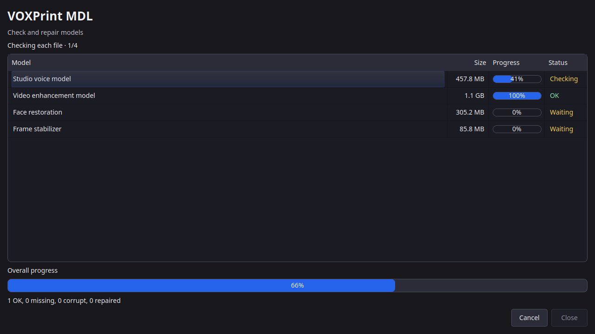

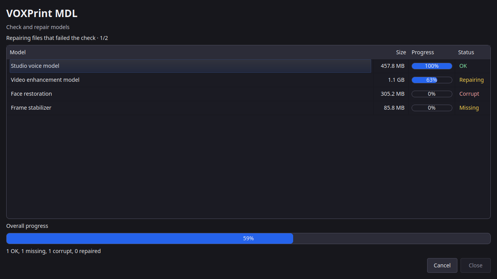

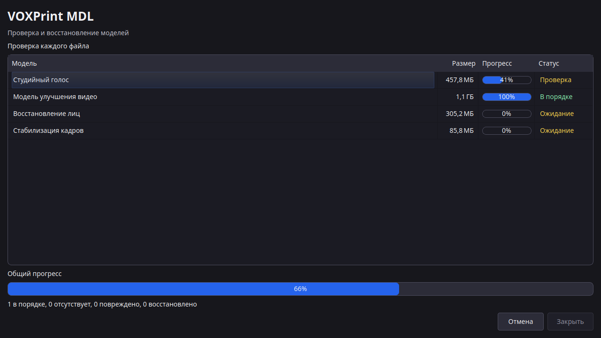

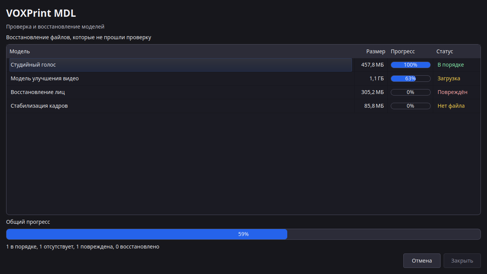

The window reads the queue in `voxprint_common.mdl.queue`. It does not write a second queue file.

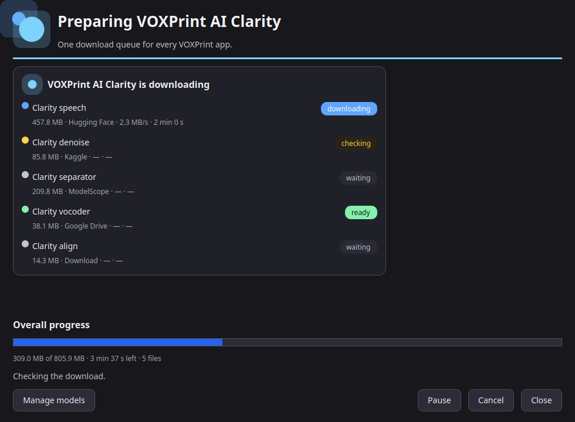

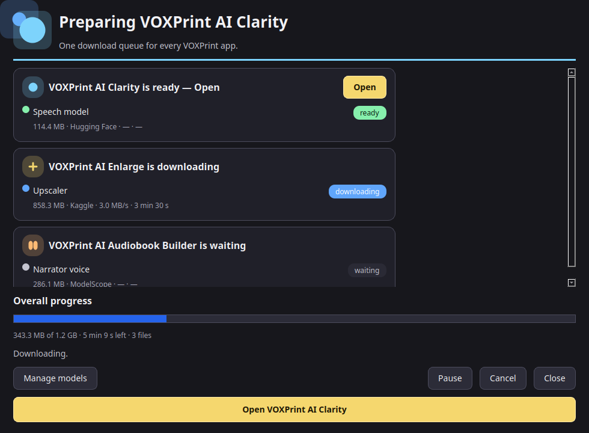

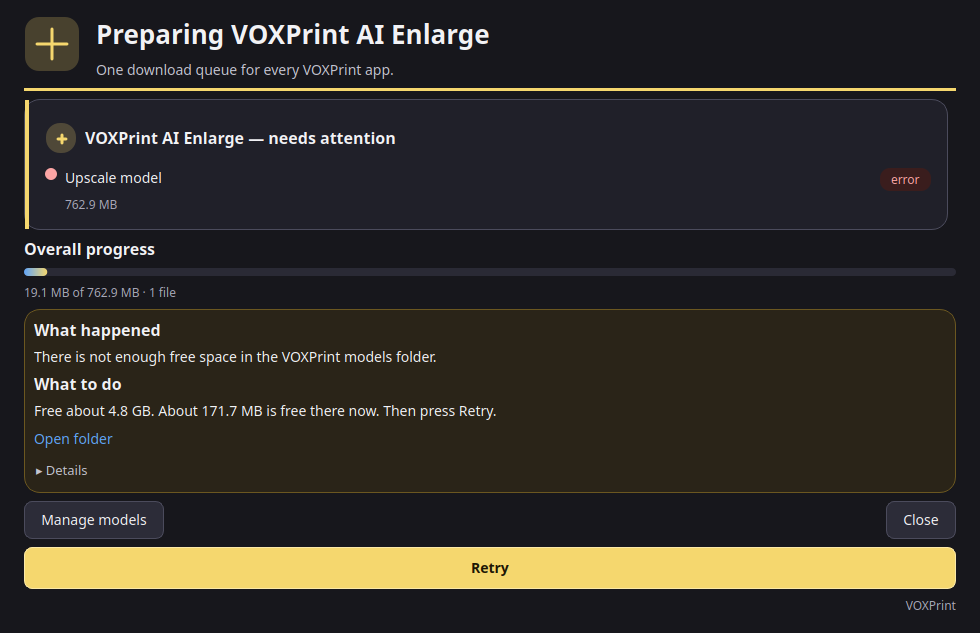

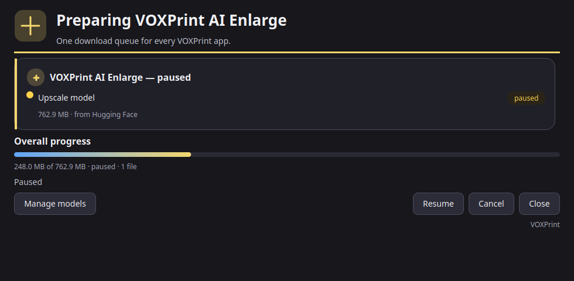

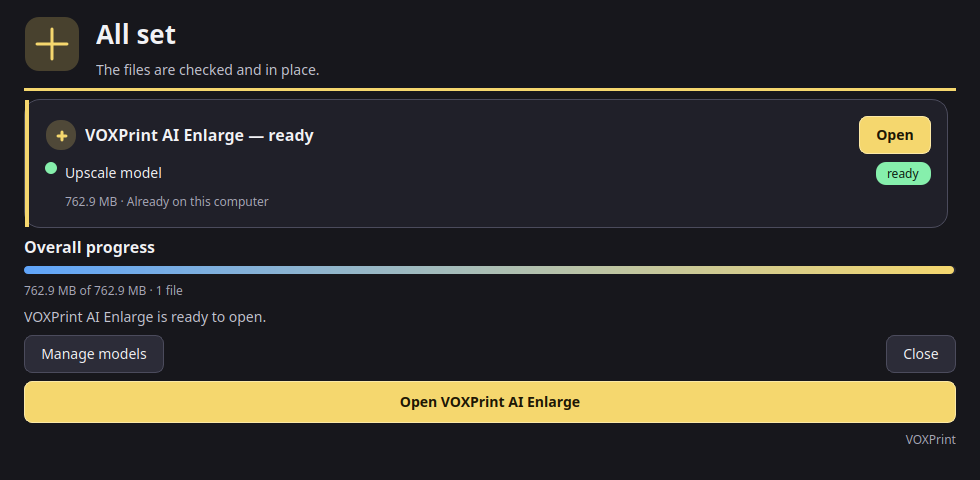

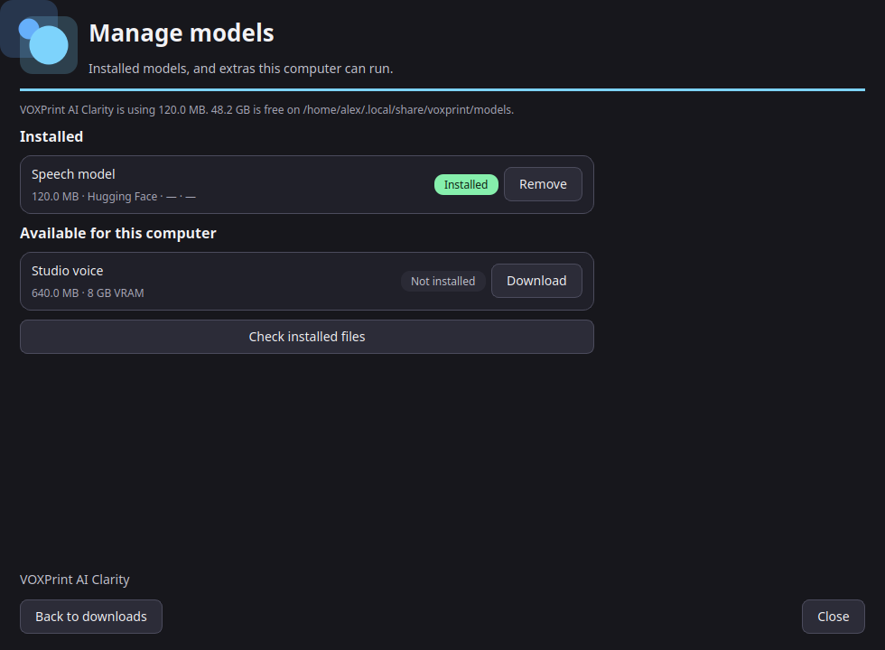

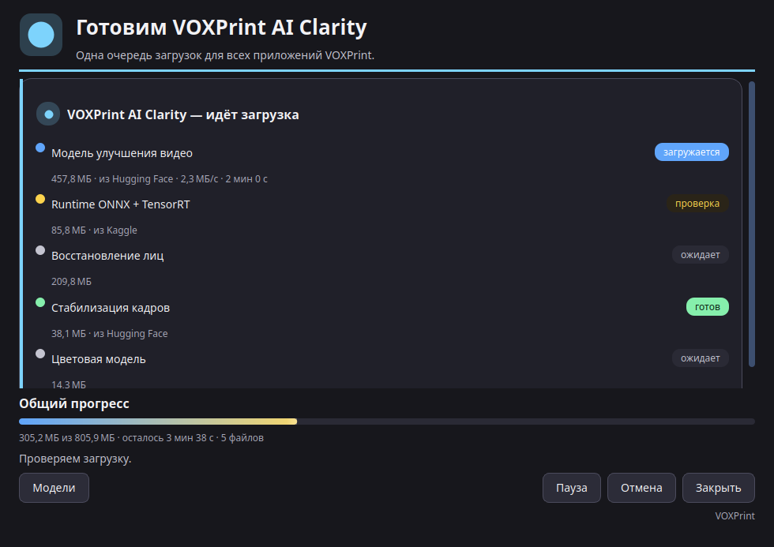

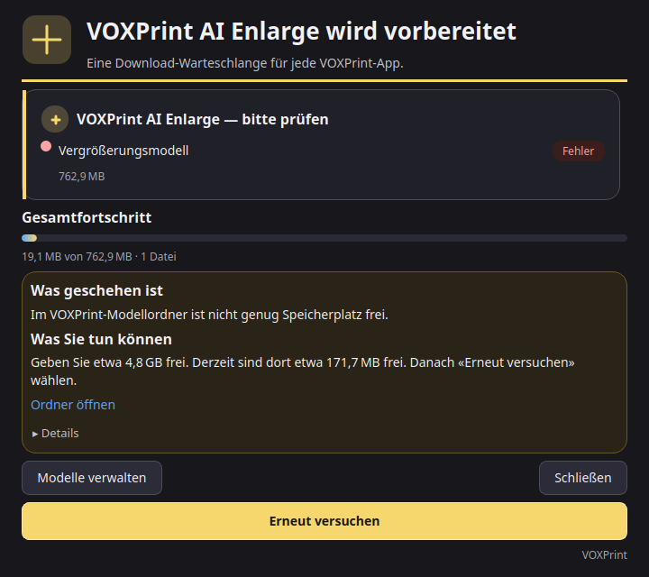

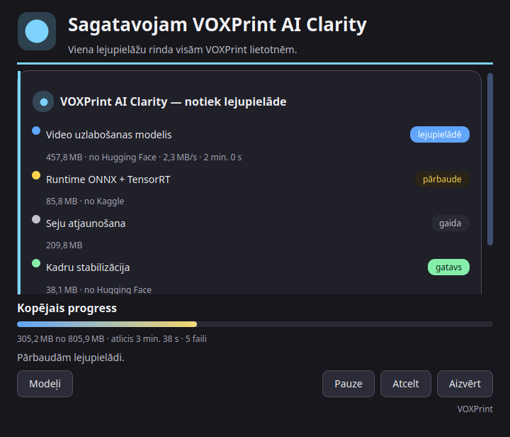

## Safety

`ready(app)` plans the detected tier and checks each required file. A missing file is `needs download`. A short file is `needs repair`. Runtime components such as `runtime-py314-torch2.11-cu130` use the size list stored on the component. The status file is not enough: a half-wiped store is not ready, and `download --app` fetches the missing files.

A component path that is the suite home, the models root, the shared runtime, voices, cache, projects, or state — or that contains one of those, or overlaps another component — is rejected. `release_component` deletes a directory only when it is a single model folder directly under the models root and neither the shared manifest nor `models/.users.json` still names a user. `verify --repair` clears a dangerous path in the manifest and does not delete the files. It then downloads models that are missing or corrupt. Writes to the manifest and to `.users.json` re-read under the lock and keep unknown keys.

## Languages

`voxprint_common.i18n` loads one JSON file per language from `ui/locales/`, beside `tokens.json`. English is the source and the fallback. The package ships `en`, `de`, `ru`, `uk`, and `lv`. The active language is the `ui_language` key when that key is present in `suite.json`, then `VOXPRINT_LANG`, then the system UI locale, then English. `add_catalogs` lets an app point at its own `locales` directory. Later folders override the same key.

Apps check their own UI in CI:

```yaml
- name: UI strings
  run: python -m voxprint_common.i18n.check --src src/<pkg> --locales src/<pkg>/locales --langs en,ru,de,uk,lv
```

The checker fails on a hard-coded user-facing string in a Qt call, a key missing from a shipped locale, or a `{placeholder}` sequence that differs between languages. An unused key is a warning. `# i18n: ignore` skips one call. Splash titles use `splash.app.<id>` and keep the same brand spelling in every language.
