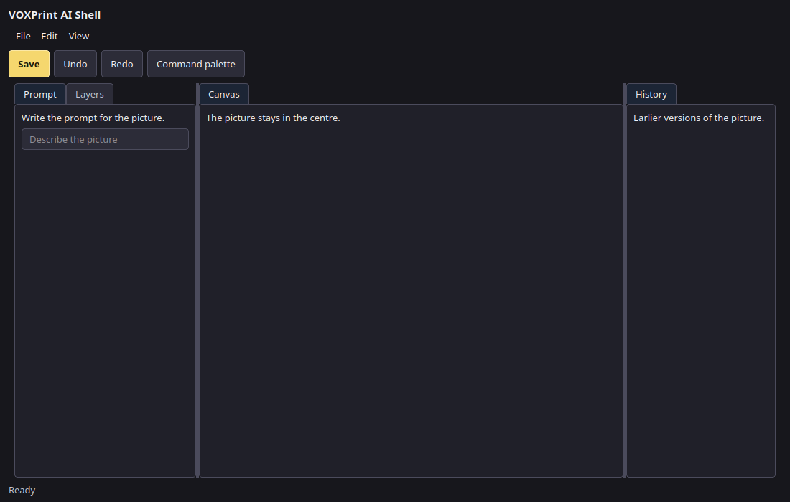
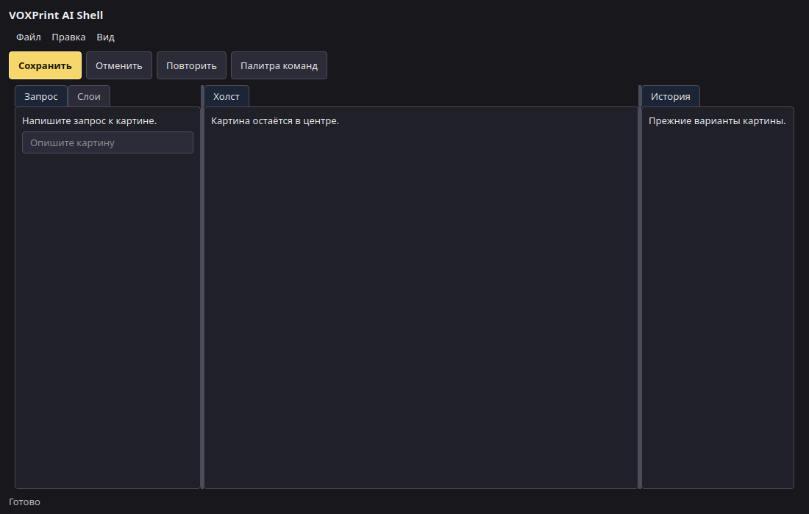
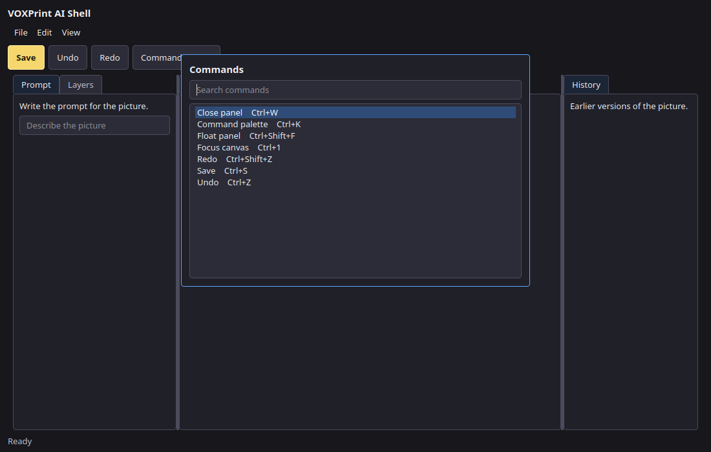
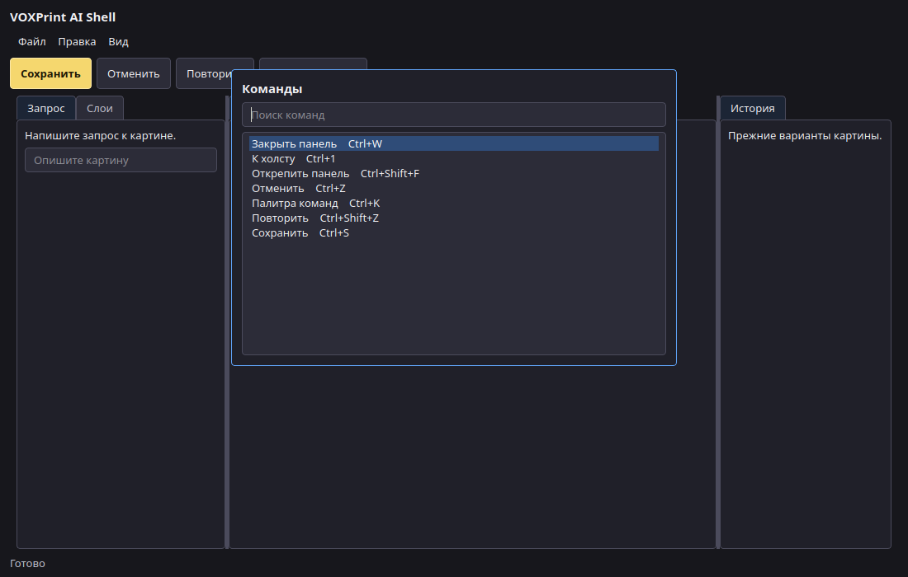

# Shared UI

Phase 1 is the headless dock, the command registry, the design tokens, and a reference window. Apps adopt it in this order: Canvas, Enlarge, Clarity, Audiobook Builder, Movie Dubber, Plotweaver, then the Lucent helper. The order is `voxprint_common.ui.shell.ADOPTION`. This library change does not edit those apps.

The Lucent viewer process does not import the dock. Its helper can use the tokens, the command registry, and the palette scorer.

## Import without Qt

```python
from voxprint_common.ui.dock import Layout, dump_layout, load_layout
from voxprint_common.ui.commands import Registry, reference_commands
from voxprint_common.ui.keymap import KeyMap, load_overrides, save_overrides
from voxprint_common.ui.palette import score_text
from voxprint_common.ui.tokens import load
```

Importing `voxprint_common`, or any of those modules, does not import PySide6. Install the `ui` extra before constructing `ReferenceShell`, `Splash`, or the download window.

## Layout

A layout is a tree of tab groups, horizontal and vertical splits, and accordion stacks, plus floating groups that stay inside the same window. `Layout.apply` clones the tree, checks it, and commits only a valid result. `DockHistory` keeps those commits for undo and redo. `layout_json` writes schema 1. `layout_from_json` rejects any other schema.

Each app stores that document itself, for example `Settings/<app>.ui.json`. The shared `state/suite.json` file stores keymap overrides, not layouts.

The centre canvas uses `Permissions.protected()`. It cannot be moved, floated, closed, or merged into as a tab. Splits beside it stay allowed. `QDockWidget` is not used.

```python
from voxprint_common.ui.dock import DockHistory, Permissions, dump_layout, load_layout
from voxprint_common.ui.shell import reference_layout

history = DockHistory(reference_layout())
history.apply(action, lambda panel: Permissions.protected() if panel == "canvas" else Permissions())
saved = dump_layout(history.layout)
restored = load_layout(saved)
```

## Commands and keys

Shared command ids are `file.save`, `edit.undo`, `edit.redo`, and `view.palette`. An app command uses the app name as a prefix, for example `canvas.generate`. The title is an i18n key. The default chord uses `Mod`, which is Ctrl on Windows and Linux and Command on macOS. A `platforms` pair replaces that chord on one system. `when` names the context that must be active. A context binding beats a global binding. A text field keeps the keys: only a command whose `when` is `text` runs while a text field is focused.

`KeyMap.assign` stores a user override and reports conflicts. `save_overrides` writes the schema 1 `keymap` object into suite settings. Unknown saved entries are dropped. Other suite keys stay as they are.

## Tokens

`tokens.json` is schema 1: a colour map, editor density, and the splash colours for Audiobook Builder, Movie Dubber, Enlarge, and Clarity. `voxprint_common.ui.theme.TOKENS` is that colour map. `build_style` remains the wizard and download-window stylesheet. `build_shell_style` uses the density block (13 px body, 28 px panel headers, 4 px control radius) with the same colours. A file whose schema is not 1 is refused.

## Reference window

`ReferenceShell` paints two side tab groups around a protected centre, a command palette, and the shell theme. Screenshots below are grabbed with `QT_QPA_PLATFORM=offscreen`.









The translucent Acrylic backgrounds are a stylesheet flag (`glass=True`). An offscreen grab cannot show operating-system blur, so these pictures use the solid background.
