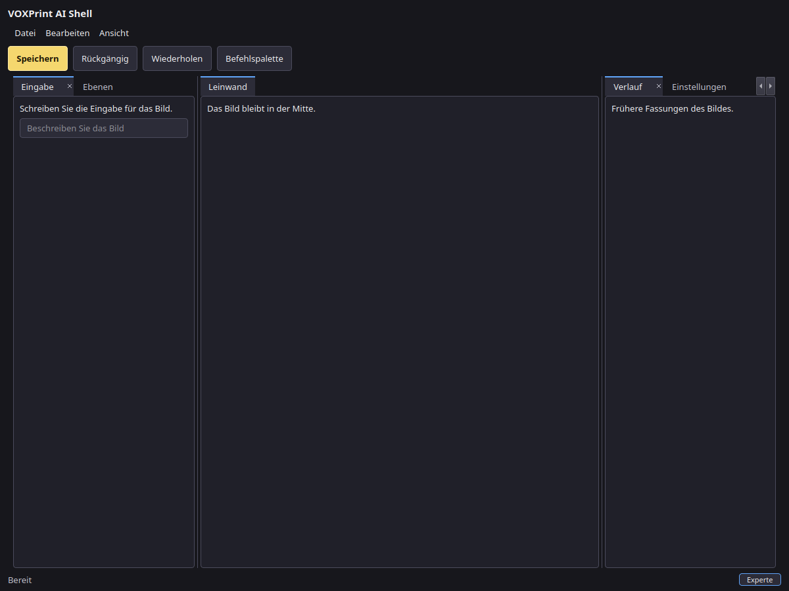
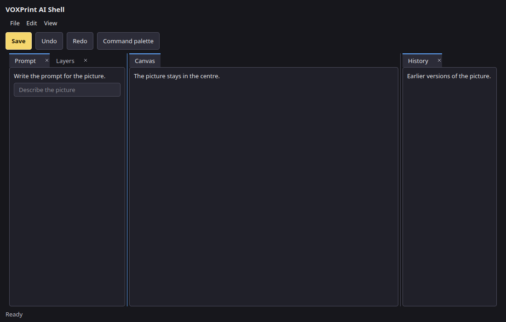
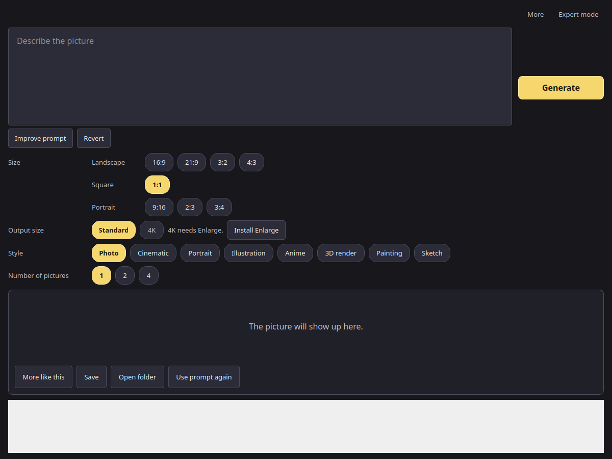
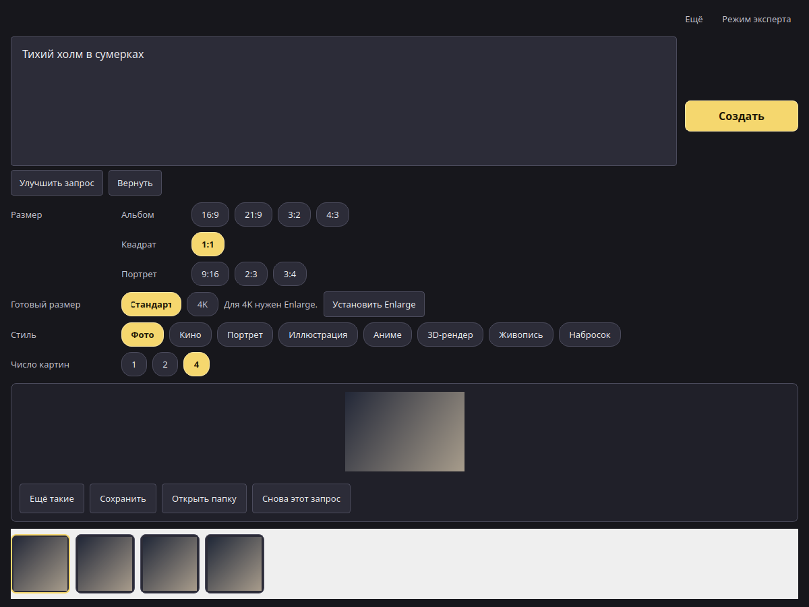
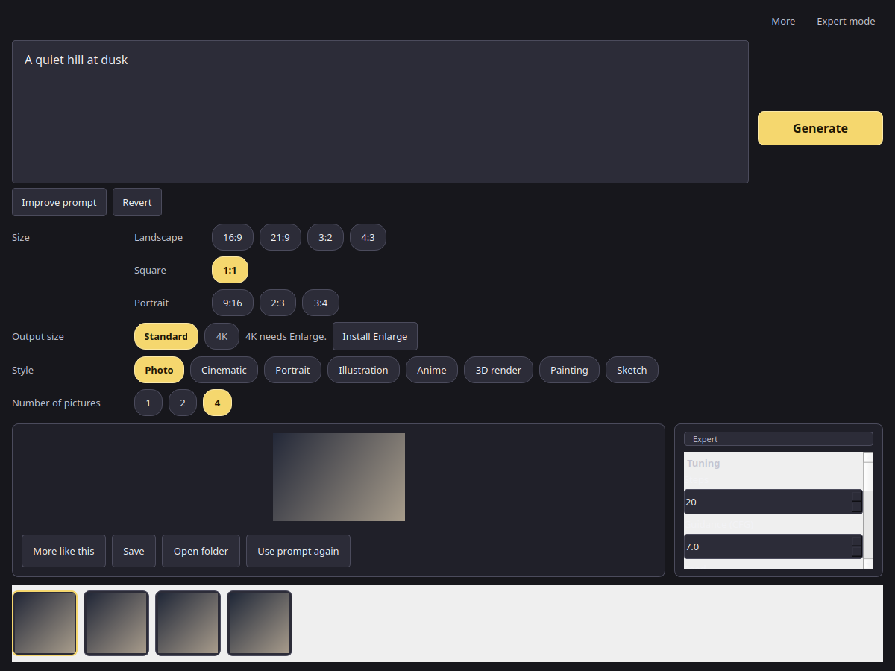

# Shared UI

Phase 1 is the headless dock, the command registry, the design tokens, and a reference window. Apps adopt it in this order: Canvas, Enlarge, Clarity, Audiobook Builder, Movie Dubber, Plotweaver, then the Lucent helper. The order is `voxprint_common.ui.shell.ADOPTION`. This library change does not edit those apps.

The Lucent viewer process does not import the dock. Its helper can use the tokens, the command registry, and the palette scorer.

## Simple by default

Every app opens in simple mode. The words are plain verbs. Simple mode has no jargon, a sensible default, and as few controls as the job allows. A control that needs a jargon word, a step count, or a sampler name is tagged `expert=True`. It is visible only when Expert mode is on.

Expert mode is one suite setting, `ui.expert_mode` in `state/suite.json`. It is off by default. `ExpertMode` stores that bool and notifies listeners when it changes. Commands, dock panels, and settings carry `expert: bool = False`. `Registry.visible`, `visible_layout`, and `Settings.visible` leave expert items out while the mode is off.

Hiding a panel does not remove it from the layout JSON. The stored tree is unchanged. Turning the mode on shows the same panels again.

Tooltips are for expert items. A simple control is labelled clearly enough that it does not need one.

`view.toggle_expert_mode` turns the mode on and off. It has no default shortcut. It is in the View menu and the command palette. The title is "Expert mode", "Режим эксперта", "Expertenmodus", "Режим експерта", and "Eksperta režīms".

A keymap binding may use the context `expert` (`WHEN_EXPERT`). That binding runs only while Expert mode is on. `active_contexts(..., expert=True)` adds the context.

### Safety gates

A minors-safety gate stays inside the app. The shared UI has no setting, hook, or function that turns that gate off. Adult content is an ordinary descriptor the app supplies. The reference shell shows it as `image.adult_content`, expert only, default off, with the help text "Pictures meant for adults." This library does not read that value and it does not classify pictures.

### Adoption checklist

Canvas adopts this first. Then Enlarge, Clarity, Audiobook Builder, Movie Dubber, Plotweaver, and the Lucent helper. The order is `voxprint_common.ui.shell.ADOPTION`. This library change does not edit those apps.

- [ ] Open in simple mode. Leave `ui.expert_mode` off until the user turns it on.
- [ ] Write simple labels as plain verbs. Leave sampler names, step counts, and other jargon out of simple mode.
- [ ] Tag advanced commands, panels, and settings with `expert=True`.
- [ ] Read the flag through `ExpertMode` and subscribe to changes.
- [ ] Keep hidden expert panels in the app layout file. Filter with `visible_layout` only for what is on screen.
- [ ] Put `view.toggle_expert_mode` in the View menu and the command palette. Do not give it a default shortcut.
- [ ] Show a muted Expert chip while the mode is on.
- [ ] Put tooltips on expert items only.
- [ ] Keep a minors-safety gate in the app. Do not add a shared control that turns that gate off. Adult content, when the app wants it, is one ordinary expert descriptor.
- [ ] Image apps (Canvas, Enlarge, and the Lucent helper) open on the image-app pattern in `SimpleImageLayout`.
- [ ] Keep Size, Style, Number of pictures, More like this, Save, Open folder, and Use prompt again on that screen.
- [ ] Expert mode only adds the side panel. Leave the rest of the screen where it is. The dock stays an API, with no switch on the image screen.

## Import without Qt

```python
from voxprint_common.ui.dock import Layout, dump_layout, load_layout, visible_layout
from voxprint_common.ui.commands import Registry, reference_commands
from voxprint_common.ui.expert import ExpertMode, active_contexts
from voxprint_common.ui.settings import reference_settings
from voxprint_common.ui.simple_image import SimpleImageLayout, image_presets
from voxprint_common.ui.keymap import WHEN_EXPERT, KeyMap, load_overrides, save_overrides
from voxprint_common.ui.palette import score_text
from voxprint_common.ui.tokens import load
```

Importing `voxprint_common`, or any of those modules, does not import PySide6. Install the `ui` extra before constructing `ReferenceShell`, `Splash`, or the download window.

## Layout

A layout is a tree of tab groups, horizontal and vertical splits, and accordion stacks, plus floating groups that stay inside the same window. `Layout.apply` clones the tree, checks it, and commits only a valid result. `DockHistory` keeps those commits for undo and redo. `layout_json` writes schema 1. `layout_from_json` rejects any other schema.

Each app stores that document itself, for example `Settings/<app>.ui.json`. The shared `state/suite.json` file stores keymap overrides, not layouts.

The centre canvas uses `Permissions.protected()`. It cannot be moved, floated, closed, or merged into as a tab. Splits beside it stay allowed. `QDockWidget` is not used.

```python
from voxprint_common.ui.dock import DockHistory, Permissions, dump_layout, load_layout
from voxprint_common.ui.shell import reference_layout

history = DockHistory(reference_layout())
history.apply(action, lambda panel: Permissions.protected() if panel == "canvas" else Permissions())
saved = dump_layout(history.layout)
restored = load_layout(saved)
```

## Commands and keys

Shared command ids are `file.save`, `edit.undo`, `edit.redo`, and `view.palette`. An app command uses the app name as a prefix, for example `canvas.generate`. The title is an i18n key. The default chord uses `Mod`, which is Ctrl on Windows and Linux and Command on macOS. A `platforms` pair replaces that chord on one system. `when` names the context that must be active. A context binding beats a global binding. A text field keeps the keys: only a command whose `when` is `text` runs while a text field is focused.

`KeyMap.assign` stores a user override and reports conflicts. `save_overrides` writes the schema 1 `keymap` object into suite settings. Unknown saved entries are dropped. Other suite keys stay as they are.

## Tokens

`tokens.json` is schema 1: a colour map, editor density, and the splash colours for Audiobook Builder, Movie Dubber, Enlarge, and Clarity. `voxprint_common.ui.theme.TOKENS` is that colour map. `build_style` remains the wizard and download-window stylesheet. `build_shell_style` uses the density block (13 px body, 28 px panel headers, 4 px control radius) with the same colours. A file whose schema is not 1 is refused.

## Image-app pattern

Canvas, Enlarge, and the Lucent helper open on one screen: `SimpleImageLayout`. The level of complexity stays the same from an empty window, through progress, to a finished picture. There is no settings dialog and no jargon. A problem is one plain sentence, such as "Write a few words about the picture."

The screen is a prompt and a yellow Generate button. Enter starts a picture. Shift+Enter adds a line. Improve prompt, when the app supplies a callback, replaces the words in that same box, and Revert puts the previous words back. There is no second prompt field.

The chips are data the app supplies. `image_presets` is Canvas's list. Size is grouped, with no orientation switch: Landscape is 16:9, 21:9, 3:2, and 4:3; Square is 1:1; Portrait is 9:16, 2:3, and 3:4. Output size is Standard or 4K. A choice can stay on the row and be unavailable, with a plain reason and an action button. When Enlarge is missing, 4K is grey and the button says Install Enlarge. Style is Photo, Cinematic, Portrait, Illustration, Anime, 3D render, Painting, and Sketch. The layout reports the chosen id. The app owns any words added to the prompt and any negative prompt. Number of pictures stays 1, 2, or 4. On the picture are More like this, Save, Open folder, and Use prompt again.

`progress(step, total, stage_label)` updates the bar while a picture is running. `stage_label` is already translated. `cancel()` returns the screen to a clean idle state. `block(reason)` and `unavailable(reason)` show a localized plain sentence in the picture area.

The history strip keeps the last 50 pictures in the app's State directory (`image-history.json`). The menu offers Open, Show in folder, Copy, Use prompt again (the words and the seed), Use as input picture, and Delete. Delete asks in that same menu before it removes the picture. The overflow menu has Manage models, which calls the app. Canvas runs `voxprint-mdl --gui --app canvas`. The reference shell records that choice and does not start the program.

Expert mode adds a side panel to the right of the picture and does not move or restyle the rest. The panel holds the descriptors the app supplied. The reference list is Steps, Guidance (CFG), Seed, Sampler, Negative prompt, Add-ons, VRAM limit, and Adult content. A path field is expert because Open folder is the everyday action.

The dock (`Layout`, and `ReferenceShell(full_layout=True)`) stays available as an API for tools that arrange panels. The image screen has no control that opens it.

```python
from pathlib import Path

from voxprint_common.ui.simple_image import SimpleImageLayout, image_presets

layout = SimpleImageLayout(image_presets(), state_dir=Path("state") / "canvas")
```

## Reference window

`ReferenceShell` opens on the image-app screen. `full_layout=True` is the dock API: two side tab groups around a protected centre, a command palette, and the shell theme. Those pictures are separate from the image screen. Screenshots below are grabbed with `QT_QPA_PLATFORM=offscreen`.







The German picture shows the close control on the active side tab. Inactive tabs keep that control hidden until the pointer is over them. The splitter picture is the root divider while it is dragged: the resting line is one pixel in the border colour, and the drag stroke is a wider accent-blue line. The hit area stays wider than the stroke and stays invisible. The translucent Acrylic backgrounds are a stylesheet flag (`glass=True`). An offscreen grab cannot show operating-system blur, so these pictures use the solid background.

Simple mode is the picture screen. Expert mode keeps that screen and adds the side panel. The result pictures are offscreen grabs of a neutral gradient, not a photograph. The English result strip holds four of those placeholders.







